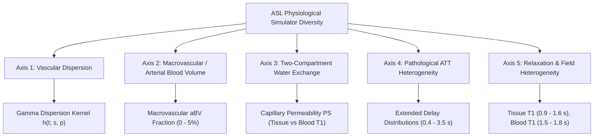

# Scientific Research Proposal: Decoupling Training-Set Size and Simulator Physiological Diversity in ASL-MRI Deep Learning

**Project:** 4-PLD Spatial U-Net for ASL CBF and ATT Estimation  
**Author:** AI Research Assistant & ASL-DNN Project Team  
**Date:** October 12, 2026  
**Status:** Ready for Future Implementation (Phase 2 Roadmap)  

---

## 1. Motivation & Context

Our empirical scaling study (`training_size_scaling_v1`) demonstrated that scaling synthetic spatial phantom count from $N=2,400$ to $N=19,200$ phantoms reduces CBF RMSE by $17.9\%$ and ATT RMSE by $13.7\%$ under the standard Single-Subtraction Standard Kinetic Model (SKM). However, the scaling exponents ($\alpha_{\text{CBF}} \approx 0.093$, $\alpha_{\text{ATT}} \approx 0.069$) reveal sharp diminishing marginal returns: further doublings within the existing generative process require exponential compute costs for marginal error reductions ($< 5\%$).

Crucially, **sample count ($N$) and distribution support ($\mathcal{P}_{\text{phys}}$) are orthogonal axes of generalization**:
- *Sample Count Scaling ($N$):* Densely samples the existing parameter distributions, reducing empirical estimation variance within the known synthetic manifold.
- *Simulator Diversity Expansion:* Broadens the support of the physiological forward model, preventing model collapse when confronted with in vivo biophysical phenomena not modeled by standard Buxton kinetic equations.

This document proposes a controlled, modular protocol to broaden the synthetic simulator across five physiological axes while maintaining strict experimental decoupling from cohort size $N$.

---

## 2. Five Physiological Axes of Simulator Diversity

### Axis 1: Vascular Dispersion
- **Biophysical Reality:** In vivo arterial blood does not travel as an idealized square plug bolus. Friction and vessel branching introduce dispersion, described by a transport kernel $h(t)$:
  $$c_{\text{art}}(t) = c_0(t) \ast h(t)$$
- **Mathematical Modeling:** Implement a Gamma dispersion kernel:
  $$h(t) = \frac{s^p}{\Gamma(p)} t^{p-1} e^{-s t}$$
  where $p$ and $s$ govern transit dispersion time and spread.
- **Simulator Implementation:** Sample dispersion parameters per vascular territory, convolving with the labeling boxcar function before entering Buxton tissue integration.

### Axis 2: Macrovascular Arterial Blood Volume (aBV)
- **Biophysical Reality:** In early PLDs (e.g. $1.525$ s), labeled blood resides in large feeding arteries before exchanging into capillary tissue beds, producing high-intensity focal intravascular signals ("bright vessel artifacts").
- **Mathematical Modeling:**
  $$\Delta M(t) = \Delta M_{\text{tissue}}(t) + \text{aBV} \cdot \Delta M_{\text{macro}}(t)$$
  $$\Delta M_{\text{macro}}(t) = 2 M_0 \alpha_{\text{inv}} c_{\text{art}}(t)$$
- **Simulator Implementation:** Add an independent ground-truth map $\text{aBV} \in [0, 0.05]$ localized along simulated major cerebral arteries (MCA, ACA, PCA).

### Axis 3: Two-Compartment Capillary-Tissue Water Exchange
- **Biophysical Reality:** Standard kinetic models assume instantaneous exchange of labeled water across the blood-brain barrier (BBB). In reality, water exchange is permeability-limited ($PS \approx 100\text{--}200$ mL/100g/min).
- **Mathematical Modeling:** St. Lawrence & Lee two-compartment kinetic model separating vascular and extravascular magnetization decay with distinct $T_{1,\text{blood}}$ and $T_{1,\text{tissue}}$.

### Axis 4: Pathological Arterial Transit Delays (Steno-Occlusive Extension)
- **Biophysical Reality:** In cerebrovascular disease (e.g. carotid stenosis, moyamoya, ischemic stroke), collateral flow pathways extend arterial transit times beyond $2.5\text{--}3.0$ seconds.
- **Simulator Implementation:**
  - Standard healthy distribution: $\text{ATT} \sim \mathcal{U}(0.7, 1.9)$ s.
  - Pathological cohort distribution: Include focal collateral territories with $\text{ATT} \sim \mathcal{U}(1.9, 3.5)$ s.
  - Test sensitivity of fixed 4-PLDs ($[1.525, 2.025, 2.525, 3.025]$ s) to transit delays exceeding the final PLD.

### Axis 5: Relaxation and Field Heterogeneity
- **Biophysical Reality:** Blood hematocrit and tissue iron alter $T_{1,\text{blood}}$ and $T_{1,\text{tissue}}$ across subjects:
  - $T_{1,\text{blood}} \in [1500, 1800]$ ms (mean $1650$ ms).
  - $T_{1,\text{gray}} \in [1200, 1500]$ ms, $T_{1,\text{white}} \in [800, 1000]$ ms.
- **Simulator Implementation:** Sample relaxation parameters as spatially continuous Gaussian random fields per phantom rather than constant scalars.

---

## 3. Decoupled Experimental Protocol

To isolate the effect of physiological diversity from sample count, we propose a $2 \times 2$ factorial experimental design:

| Condition Name | Training Sample Count ($N$) | Forward Model Complexity | Physiological Support |
| :---: | :---: | :---: | :---: |
| **Standard Baseline** | $N=4,800$ | Standard Buxton Kinetic Model | Healthy parameter bounds |
| **Sample-Scaled** | $N=19,200$ | Standard Buxton Kinetic Model | Healthy parameter bounds |
| **Diverse-Standard-N** | $N=4,800$ | 5-Axis Diverse Simulator | Broadened healthy + pathological |
| **Diverse-Scaled-N** | $N=19,200$ | 5-Axis Diverse Simulator | Broadened healthy + pathological |

### Evaluation Battery
1. **In-Distribution Cohort:** $N=100$ phantoms generated under the matching forward model.
2. **Stress-Test Challenge Cohort (`challenge_test_N40_s2026.npz`):** Contains severe vascular dispersion, elevated aBV, and prolonged ATT ($> 2.5$ s).
3. **In Silico Sensitivity Indices:** Sobol sensitivity analysis measuring how uncertainty in $T_{1,\text{blood}}$ and dispersion propagates into CBF/ATT error.

---

## 4. Expected Impact

1. **Elimination of Vascular Artifacts:** Training with explicit macrovascular aBV will enable the spatial U-Net to segment and suppress intravascular transit artifacts, preventing massive local CBF overestimation.
2. **Clinical Generalizability:** Robust parameter estimation under collateral circulation where ATT exceeds $2.5$ s.
3. **Decoupled Science:** Conclusively distinguishes whether deep learning performance bottlenecks in ASL-MRI are caused by data starvation ($N$) or physical model misspecification ($\mathcal{P}_{\text{phys}}$).
